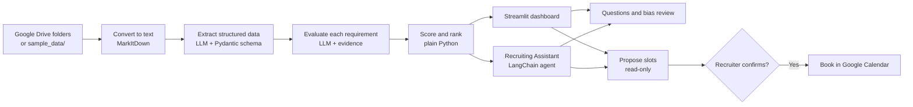

# HireSense

**AI-powered candidate screening, ranking, and scheduling, with evidence for every decision.**

HireSense reads a job description and a set of resumes, then gives a recruiter a ranked shortlist. Every score traces back to per-requirement evidence from the resume. It can also generate tailored interview questions, review its own reasoning for bias, and book interviews once a recruiter confirms a time.

Built during an agentic AI workshop in Berlin (July 2026).

## Features

- **Structured extraction:** turns resumes into `Candidate` records and job descriptions into essential and preferred requirements.
- **Evidence-based ranking:** decides requirement by requirement whether a candidate qualifies, and cites the supporting resume text.
- **Transferable skills:** recognizes related skills and different terminology (for example, Django counting toward "backend web framework experience") and labels those matches.
- **Gap detection:** flags missing information and internal inconsistencies, such as overlapping employment dates.
- **Tie flagging:** marks candidates within 3 points of each other for a recruiter to separate, rather than silently breaking the tie.
- **Filtered ranking:** re-ranks by any mix of experience, skills, education, and certifications without new LLM calls.
- **Interview questions:** targets each candidate's gaps and unverified claims, with a PDF download.
- **Bias review:** re-reads the evaluation's reasoning for proxies such as graduation year or school prestige. It flags them for a human and changes nothing itself.
- **Disputes:** lets a recruiter mark an evaluation as disputed, with an optional note shown as a badge on the candidate.
- **Scheduling:** finds free slots across interviewers' calendars and books one with Google Calendar invites.
- **Recruiting Assistant:** a chat agent with six tools over the same candidate data.

## How it works



A full load makes one LLM call for the job description and two per resume, one to extract and one to evaluate. Resumes whose text hasn't changed are reused on refresh.

### Scoring

The LLM decides whether each requirement is met. The score is then calculated in Python rather than self-reported by the model:

```text
score = 100 × (0.75 × essential requirements met ÷ essential total
             + 0.25 × preferred requirements met ÷ preferred total)
```

The dashboard labels 80 and above as **Strong**, 50 to 79 as **Possible**, and below 50 as **Weak**.

## What was used

Versions are the ones pinned in [`recruitment-app/uv.lock`](recruitment-app/uv.lock).

| Area | Technology | Used for |
|---|---|---|
| Language | Python 3.11–3.13 | The whole application |
| UI | Streamlit 1.60, custom CSS | Landing page, dashboard, floating chat widget |
| LLM | Claude Haiku 4.5 (`anthropic/claude-haiku-4-5`) | Extraction, evaluation, questions, bias review, chat |
| LLM gateway | LiteLLM proxy (OpenAI-compatible API) | Routes every model call |
| Agent | LangChain 1.3 (`create_agent`, tools), LangGraph 1.2, `langchain-openai` 1.4 | Tool-calling Recruiting Assistant and streamed replies |
| Structured output | Pydantic 2.13 with `with_structured_output` | Constrains LLM responses to fixed schemas |
| Document parsing | MarkItDown 0.1 | PDF, Word, Excel, and PowerPoint to text |
| Google integration | Drive API v3, Calendar API v3, OAuth 2.0 | Read resumes and job descriptions, check availability, book interviews |
| PDF generation | fpdf2 2.8 | Interview question downloads |
| Development | uv, JupyterLab, `python-dotenv` | Dependencies, walkthrough notebooks, local configuration |

## Getting started

You need [uv](https://docs.astral.sh/uv/) and a `LITELLM_API_KEY`. No Google setup is needed to try it on the sample data.

```bash
git clone https://github.com/halakhalil5/recruitement-app.git
cd recruitement-app/recruitment-app
uv sync
cp .env.example .env                     # then set LITELLM_API_KEY
uv run streamlit run recruiter_app.py
```

Click **Get Started** to rank the three synthetic resumes in `sample_data/` against the sample job description.

To explore the same pipeline one step at a time, run `uv run jupyter lab` and open the notebooks.

**Using a different LLM endpoint:** the proxy URL and model are hard-coded in [`recruiting/llm.py`](recruitment-app/recruiting/llm.py), and the default proxy needs a workshop-issued key. To use another OpenAI-compatible endpoint, change `BASE_URL` and `MODEL` there and put your key in `LITELLM_API_KEY`.

**Using live Google Drive and Calendar:** follow the [OAuth setup steps](recruitment-app/README.md#google-oauth-drive--calendar-if-you-want-the-live-version).

## Repository structure

```text
.
├── recruitment-app/          # HireSense
│   ├── recruiter_app.py      # Streamlit UI and chat agent
│   ├── recruiting/           # Core package: no UI or agent code
│   │   ├── extract.py        # Text to structured Candidate / JobDescription
│   │   ├── matching.py       # Evaluation, scoring, ranking
│   │   ├── interview.py      # Personalized interview questions
│   │   ├── bias.py           # Bias review of evaluation reasoning
│   │   ├── drive_client.py   # Google Drive (read-only)
│   │   ├── calendar_client.py# Free/busy lookup and booking
│   │   ├── auth.py           # Shared Google OAuth
│   │   ├── llm.py            # The single model configuration
│   │   └── models.py         # Dataclasses
│   ├── sample_data/          # Synthetic resumes and job description
│   └── 00–04-*.ipynb         # Step-by-step walkthrough notebooks
├── cms-app/                  # Workshop app: GUC CMS as agent tools
└── portal-app/               # Workshop app: GUC student portal client and agent tools
```


## Known limitations

- **Job description edits don't re-score existing candidates.** Evaluations are reused whenever a resume's text is unchanged, even if the requirements changed.
- **The evaluator can still see personal details.** The extraction schema omits age, gender, and similar fields, but the evaluation prompt receives the raw resume text.
- **Booking confirmation in chat relies on the prompt.** The dashboard requires a button click, but the agent's `book_interview` tool only checks that the slot index is valid.
- **The chat has no memory between messages.** Each message reaches the agent alone, so follow-ups like "explain more" lack context.
- **Filtered scores can be inflated.** A category with no essential requirements counts as 100% essential coverage, so a candidate who meets none of its preferred requirements still scores 75.
- **Scheduling is UTC-only.** Working hours are fixed at 09:00–17:00 UTC, Monday to Friday.
- **Input is limited to two sources.** Files come from Google Drive or the local sample `.txt` files. There is no upload in the UI, and scanned PDFs are rejected because there is no OCR.
- **Model output is rendered as HTML unescaped.** Evidence and notes derived from resumes go through `unsafe_allow_html`, so the app shouldn't process untrusted resumes as it stands.
- **It isn't production-ready.** There are no automated tests, CI, or deployment configuration, and state is held in the browser session.

HireSense supports recruiter judgment and doesn't replace it. Its evaluations are LLM output and need human review before they inform a hiring decision.
